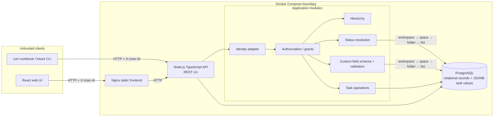
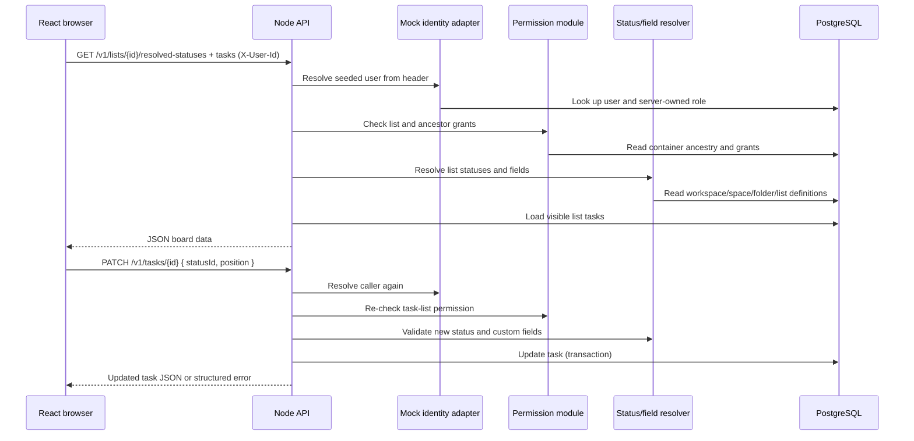

# Flowboard

Flowboard is a single-team project-management app built for the full-stack take-home assignment. It includes a workspace hierarchy, scoped status and custom-field configuration, permission-aware task APIs, and Kanban and list views.

> **Submission note:** the repository owner requested that all Markdown files be kept local and ignored by Git. Therefore this README is present only in the local working directory and will not appear in a GitHub checkout unless that policy is changed before submission.

## Run the complete app

Docker Compose is the supported clean-machine path. Docker Desktop must be running.

```sh
docker compose up --build
```

Open the UI at <http://localhost:8080>; the versioned API is at <http://localhost:3000/v1> and its health endpoint at <http://localhost:3000/health>. PostgreSQL is exposed on port 5432 for local inspection. A one-shot `db-init` Compose service applies migrations and seeds demo records before the API starts; the seed detects an existing workspace and leaves its data untouched on later restarts.

Optional local configuration can be created by copying `.env.example` to `.env`. Defaults are local-only demo values, not production secrets. To reset the local database and seed from scratch, stop Compose and remove its `postgres_data` volume intentionally.

### Demo identities

Choose a user in the top-right selector or send the identity header:

- **Alice Chen (`alice`)** — workspace admin; can access all containers and configure statuses and custom fields.
- **Bob Rivera (`bob`)** — member; can access Engineering's granted lists, but not private Product work.
- **Carol Okafor (`carol`)** — member with different grants; can access Product's private Roadmap list, but is denied Engineering.

The `X-User-Id` header is a mock assignment identity only. The server looks up the user and role; callers cannot choose their role in the request body. This is not real authentication and must not be exposed as a production security boundary.

## System design

The current system is a modular monolith: one stateless TypeScript API process with explicit domain modules and one PostgreSQL database. The React SPA and curl/other future clients share the same versioned REST contract. Docker Compose is the local trust/deployment boundary.



### Board-load and drag-card request flows



**Trust boundaries:** browsers and CLI are untrusted; identity headers are only mock input; server-loaded user records and grants determine access. The API validates every write regardless of frontend behavior. Database foreign keys protect stable relationships. The Docker network separates service-to-service database access from browser-facing ports. Production deployment requires TLS, real OIDC/session authentication, secret management, an explicit production CORS allowlist, and operational hardening.

**Where rules live:** status resolution and custom-field schema resolution run in the API domain layer over structured database definitions. Task request values are checked there against the resolved list configuration. Authorization is checked by the API before task/config reads or writes. React controls what is displayed; it is never the access-control enforcement point.

## Domain model and inheritance

The hierarchy is **Workspace → Space → Folder → List → Tasks**. Every task belongs to exactly one primary List.

A list's resolved statuses and custom fields are assembled in ancestor order: workspace defaults, then Space, Folder, and List definitions. Definitions merge by stable key:

- A nearer definition replaces a matching key.
- A new key adds a status or field.
- An explicitly disabled status hides an inherited status.
- Every resolved status set retains at least one `not_started`, `active`, and `done` category.
- A task's `statusId` must refer to a status in the list's resolved set.
- Custom values are keyed by stable field key and validated against the resolved field type, requiredness, and select options.

Status and field definitions are relational records so owners, order, keys, and types can be queried and validated. Task custom values are stored as a PostgreSQL JSONB object because different lists can have different schemas. TypeScript types describe expected shapes during development; runtime Zod checks and domain validation are still required for network data.

Task moves are atomic. The API checks the destination permission, resolves its status/field rules, then rejects a move if the old status is not valid or a required value is missing. It does not silently remap a status or drop custom data. Configuration additions that would invalidate task values/statuses are blocked. Containers are archived and tasks soft-deleted rather than immediately erased.

## REST API overview

All application routes are under `/v1`. Protected routes require `X-User-Id: alice|bob|carol`. Collections support cursor pagination with a maximum page size of 100. Errors use `{ "error": { "code": "...", "message": "...", "details": [...] } }`; malformed request input returns 400, missing/unknown identity returns 401, denied access returns 403, and unavailable resources return 404.

| Method | Route | Purpose |
| --- | --- | --- |
| GET | `/health` | Process health probe; no identity required |
| GET | `/v1` | API discovery and endpoint/error overview; no identity required |
| GET | `/v1/me` | Current server-resolved demo user |
| GET | `/v1/containers/tree` | Containers visible to current user |
| POST | `/v1/containers` | Create a Space, Folder, or List (admin) |
| PATCH | `/v1/containers/{id}` | Rename, reorder, or change visibility (admin) |
| POST | `/v1/containers/{id}/archive` | Archive a container (admin) |
| GET | `/v1/lists/{id}/resolved-statuses` | Effective Kanban statuses for a List |
| GET | `/v1/lists/{id}/resolved-fields` | Effective custom-field definitions for a List |
| POST | `/v1/lists/{scopeId}/statuses` | Add status definition at a Space, Folder, or List scope (admin) |
| POST | `/v1/lists/{scopeId}/fields` | Add custom-field definition at a Space, Folder, or List scope (admin) |
| GET | `/v1/lists/{id}/tasks?cursor=&limit=` | Paginated task collection for a List |
| POST | `/v1/lists/{id}/tasks` | Create a validated task in a List |
| GET | `/v1/tasks/{id}` | Read task detail and resolved custom-field schema |
| PATCH | `/v1/tasks/{id}` | Update task fields, status, custom values, or position |
| POST | `/v1/tasks/{id}/move` | Move task to another List after destination validation |
| POST | `/v1/tasks/{id}/archive` | Soft-delete/archive task |

## Curl cookbook: second client channel

The curl examples call the same API used by the SPA:

```sh
# Public health and API discovery
curl http://localhost:3000/health
curl http://localhost:3000/v1

# Use Alice, Bob, or Carol for seeded demo identity
curl -H 'X-User-Id: alice' http://localhost:3000/v1/me
curl -H 'X-User-Id: bob' http://localhost:3000/v1/containers/tree

# After selecting a List ID from the tree response:
curl -H 'X-User-Id: alice' 'http://localhost:3000/v1/lists/LIST_ID/resolved-statuses'
curl -H 'X-User-Id: alice' 'http://localhost:3000/v1/lists/LIST_ID/resolved-fields'
curl -H 'X-User-Id: alice' 'http://localhost:3000/v1/lists/LIST_ID/tasks?limit=20'

# Create a task using one resolved status ID. Include required custom fields.
curl -X POST 'http://localhost:3000/v1/lists/LIST_ID/tasks' \
  -H 'X-User-Id: alice' -H 'Content-Type: application/json' \
  -d '{"title":"Review deployment plan","statusId":"STATUS_ID","customFields":{"estimate":3}}'

# Update a task and move its Kanban position.
curl -X PATCH 'http://localhost:3000/v1/tasks/TASK_ID' \
  -H 'X-User-Id: bob' -H 'Content-Type: application/json' \
  -d '{"statusId":"STATUS_ID","position":4}'
```

The channel boundary is intentionally thin: both clients share endpoint contracts, identity parsing, permission checks, validation, and task behavior. Board presentation, dialogs, and local view selection remain UI concerns.

## Scale, persistence, and future IPC

API instances hold no user/session state and can be replicated behind a reverse proxy/load balancer. PostgreSQL indexes cover container parent/order, owner/order for configuration, list/status/position for board reads, and list/update time. A board load resolves the bounded ancestor chain and fetches a page of tasks. Frequently used custom-field filters can start with PostgreSQL JSONB expressions/GIN indexes or dedicated expression indexes after query measurement; do not index every custom key speculatively.

The MVP is one process and uses synchronous database transactions; there is no asynchronous IPC path because no required behavior needs a worker. If activity feeds or full-text search are added in week 2–4, the API would write a durable outbox record in the same transaction as the task update. A worker would poll/consume events, use the event ID as an idempotency key, retry transient failures with backoff, and send poison events to an observable dead-letter path. Search/activity reads can be eventually consistent. Candidate extraction seams are identity, activity/notifications, and search; split only when independent scaling or ownership warrants the network and operations cost.

## Technology choices and trade-offs

| Technology/approach | Why chosen | Alternative and cost |
| --- | --- | --- |
| TypeScript/Node.js | Same language across client/server; quick iteration; shared domain/API types; appropriate for a small I/O-heavy API. | Go offers efficient standalone services and strong compile-time checks, but adds a second language and reduces skill/type reuse here. Runtime JSON still needs validation. |
| React | Allowed stack, broad component ecosystem, strong fit for interactive board/detail workflows. | Vue is equally capable and offers integrated conventions; switching does not improve a specific assignment requirement. |
| PostgreSQL | Foreign keys, constraints, transactions, and JSONB combine strong relational integrity with flexible task values. | MongoDB is flexible but makes hierarchy/config relationships less directly constrained; SQLite is simpler but less representative of the required database service and scale story. |
| REST | Resource URLs, HTTP methods, status codes, and curl are easy to inspect and reuse across clients. | GraphQL can reduce over-fetching and aggregate UI data but adds schema/resolver/auth complexity for one SPA and a small CLI surface. |
| Modular monolith | One API deployment and transaction boundary with explicit domain seams; easy to run, test, and split later. | Microservices introduce network failures, retries, distributed observability, and consistency concerns before they benefit the MVP. |
| JSONB task values + relational field definitions | New task attributes can vary by List; field definitions remain queryable and typed. | One SQL column per possible custom field cannot support user-defined fields; fully schemaless documents make shared constraints/joins harder. |
| Archive/soft-delete | Reversible and avoids breaking references. | Hard delete is simpler but permanently loses data and risks orphaning relationships. |

## Development and test commands

Docker Compose is the supported evaluation path. For local development, install dependencies with `npm install`, ensure PostgreSQL is available, set `DATABASE_URL`, run `npm run db:generate`, `npm run db:migrate`, and `npm run db:seed`, then use `npm run dev`.

The automated checks are `npm run typecheck`, `npm run lint`, `npm test`, and `npm run build`. Backend tests cover the pure configuration resolver, task validation, and basic HTTP identity/discovery behavior. A frontend component test covers choosing a List, seeing its resolved Kanban columns, opening a task, editing a custom field, and saving. The production database-backed permission/move/config safety cases should also be run through Compose once Docker is available.

## Day 5 / next steps

1. Expand integration tests against a disposable PostgreSQL database for Alice/Bob/Carol tree visibility, denied task reads, cross-list moves, required-field validation, config changes while in use, and archive ancestry.
2. Add keyboard-accessible drag-and-drop or dedicated move controls and stronger concurrency handling for simultaneous reorder operations.
3. Add filter/sort controls and full pagination in the SPA.
4. Add real OIDC/session authentication and environment-specific CORS/TLS/secret policy for deployment.
5. Add OpenAPI generation and CI to run typecheck, lint, tests, builds, and Compose smoke tests.
6. Add durable outbox + activity worker only if activity/search becomes a real requirement.

## AI usage log

AI assistance (GitHub Copilot) was used for project scaffolding, API/domain implementation, UI implementation, and test authoring. The generated work was checked with TypeScript, ESLint, Vitest, and production builds. During the UI test loop, the initial test was corrected to exercise an actual List switch and to register Testing Library matchers; a React hooks lint finding led to moving loading-state updates into user interactions. AI suggestions were treated as drafts: runtime validation, permission enforcement, seed restart behavior, and task/config consistency received explicit attention. No credential or API key was used.
